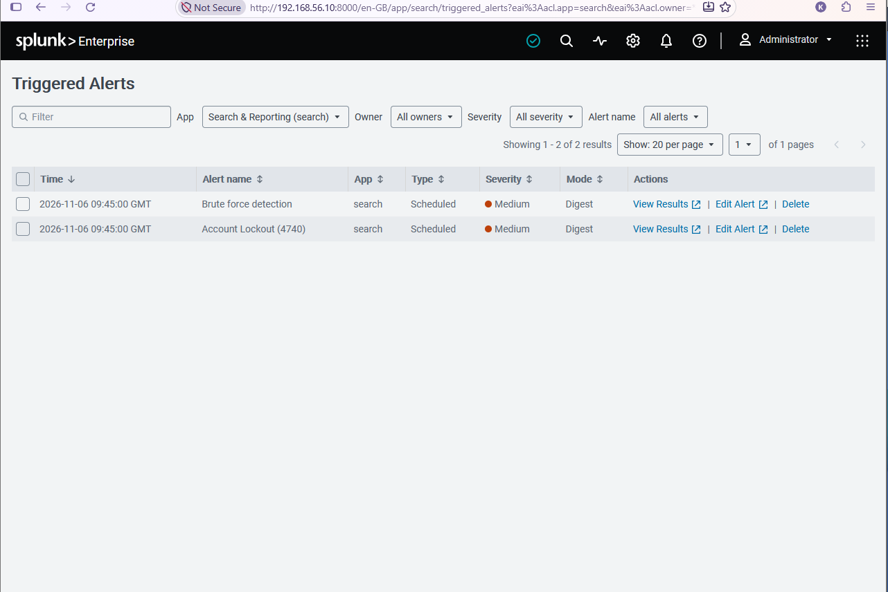
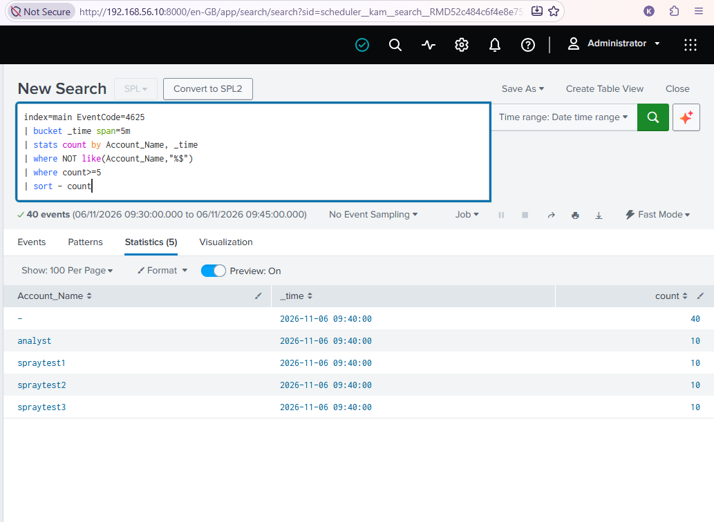
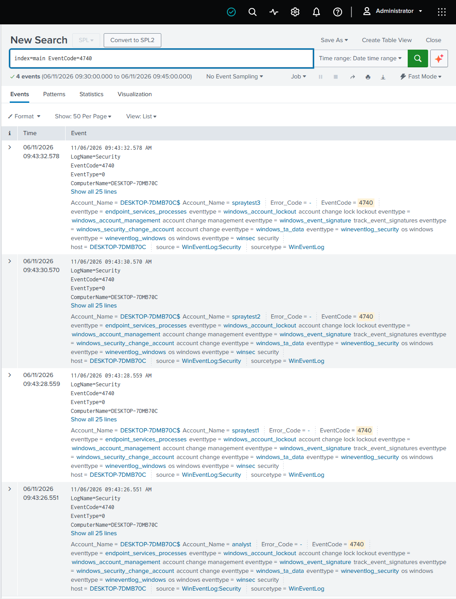

# Detections

Searches I have saved as alerts in my lab Splunk. For each one I write down what it catches, what it misses and how far I have tested it. They run on my home lab data (Windows Security log from one Windows 11 VM in `index=main`), so the index names and thresholds would need tuning anywhere else.

| Rule | Event | Built | Tested against | Seen firing as a live alert |
|---|---|---|---|---|
| [Password guessing on one account](#password-guessing-on-one-account) | 4625 | 28 Oct 2026 | 28 Oct and 6 Nov exercises | Yes, 2 Nov 2026 |
| [Account lockout](#account-lockout) | 4740 | 28 Oct 2026 | 28 Oct and 6 Nov exercises | Yes, 2 Nov 2026 |

Both fired live for the first time on 2 November, when I re-ran the attack and watched them appear in Triggered Alerts.

One thing needed fixing. Each alert fired three times for a single attack. The rule runs every 5 minutes but looks back over the last 15, so the same failed logins were counted in three overlapping runs, and each run crossed the threshold. The logic was right. The schedule was double-counting. I added a 15 minute throttle, so once an alert fires it stays quiet for 15 minutes instead of re-firing on events it has already reported. I re-tested on 6 November and got one entry per rule.

{ loading=lazy }
*Figure 1. 6 November: one spray, one Triggered Alerts entry per rule.*

## Password guessing on one account

```
index=main EventCode=4625
| bucket _time span=5m
| stats count by Account_Name, _time
| where NOT like(Account_Name,"%$")
| where count>=5
| sort - count
```

- **What it does:** counts failed logons per account in 5 minute buckets and keeps any account with 5 or more.
- **Schedule:** every 5 minutes (cron `*/5 * * * *`), searching the last 15 minutes. Triggers when there is at least one result. Action: Add to Triggered Alerts.
- **Why 5:** the lockout policy on the VM locks an account at 10 failures. A threshold of 5 warns while the guessing is still going on, not only after the lock.
- **Why the `$` filter:** a 4625 holds two account names, the computer account that handled the request and the account that failed. `Account_Name` is a multivalue field, so `stats` splits each event into one row per name. Computer account names end in `$`, and the filter drops those rows. It has to come after `stats`, where each row holds a single name.
- **Watch out for:** `span=5` without the `m` means 5 seconds, and the rule would never fire on this data.
- **Catches:** many wrong passwords against one account in a short time, for example the 10 failures in about 18 seconds on 28 Oct.

{ loading=lazy }
*Figure 2. 6 November: the rule's own search during the spray. Each account went over the threshold of 5.*

- **Misses:** password spraying, where one password is tried across many accounts. Each account stays under 5. It also misses slow guessing spread out so that no 5 minute bucket reaches 5, and a burst that is split across two buckets (for example 3 in one and 3 in the next).
- **Likely false positives:** a user who has forgotten a password and keeps retrying, or a service or saved session still using an old password.

## Account lockout

```
index=main EventCode=4740
```

- **What it does:** fires on any account lockout.
- **Schedule:** same as above, every 5 minutes over the last 15 minutes. Action: Add to Triggered Alerts.
- **Why a separate rule:** a lockout is rare and worth a look on its own. It is logged as Audit Success, not Audit Failure, so a rule that only looks at failed audits would never see it.
- **Misses:** anything that stays under the lockout threshold, including spraying.

{ loading=lazy }
*Figure 3. 6 November: four lockouts, one for each account in the spray.*

- **Note:** for a local account the 4740 often leaves the caller computer name blank, as it did here. In a domain, the domain controller's 4740 should name the source machine.

## Still to build

- **Password spraying:** many different accounts failing from one source address in a short window. Pivot on the source, not the account.

On 6 November I ran a spray against four accounts at once. The password guessing rule above did fire, but only because my test put about 10 failures on each account, well over the threshold of 5. A real spray tries roughly one password per account, stays under the threshold, and would slip past this rule. So this still needs its own detection: count the distinct accounts failing from one source address over a longer window, not the failures per account.
