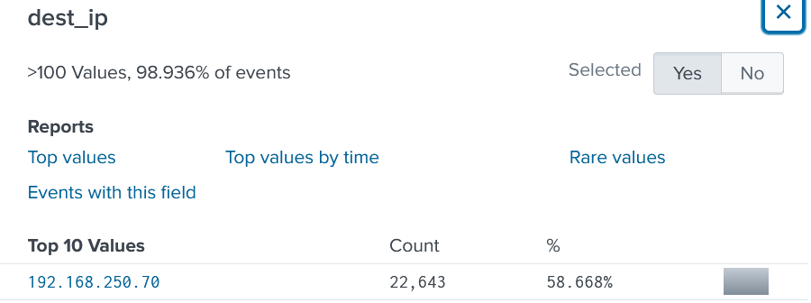
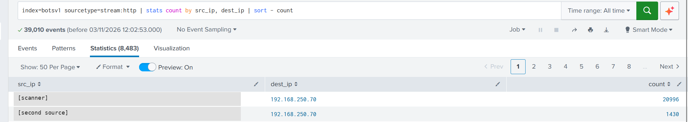
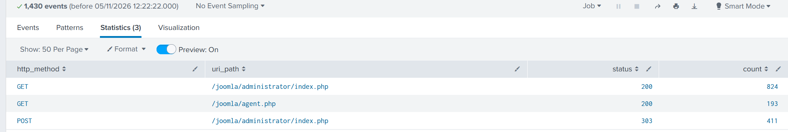
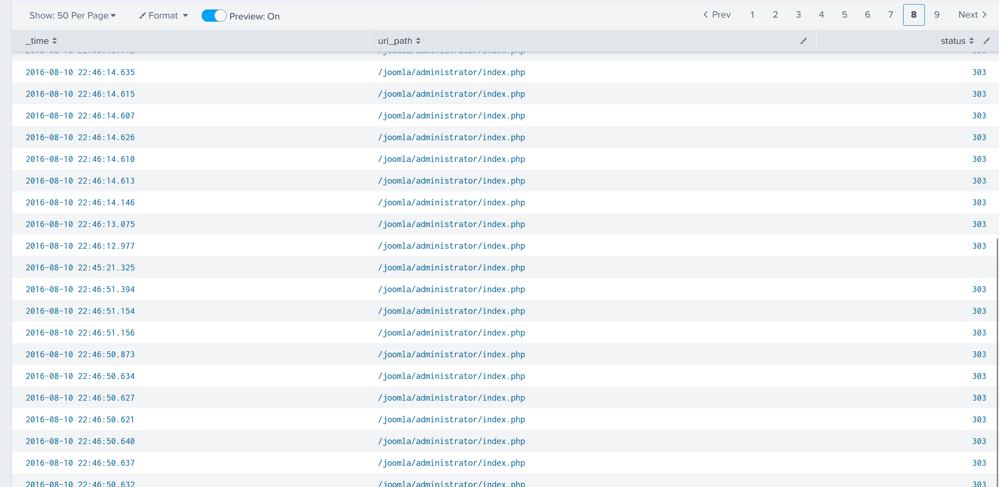
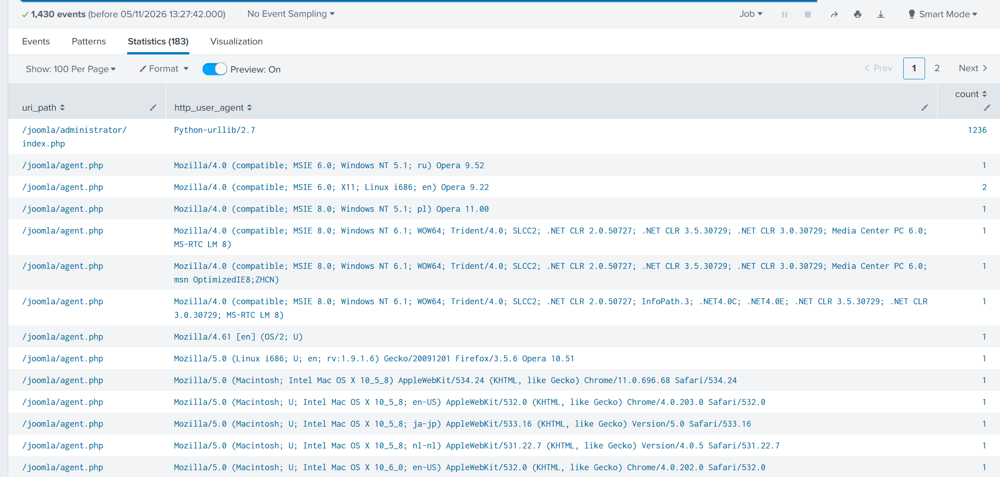
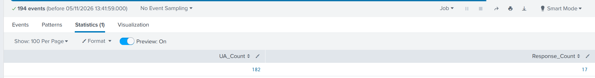
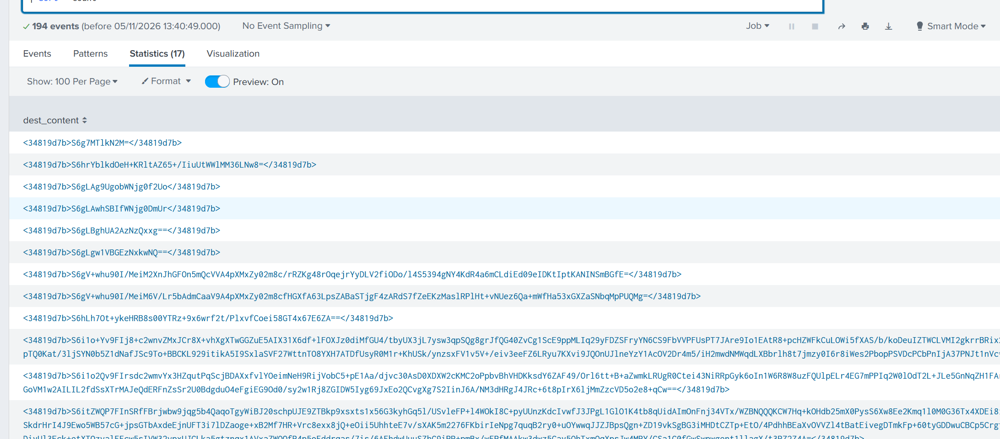

# Hunting in BOTS v1: from a scanner to a quieter second source

**Period covered:** 3 and 5 November 2026
**Dataset:** Splunk "Boss of the SOC" v1 (BOTS v1), `stream:http` sourcetype
**Tools:** Splunk Enterprise 10.4.1
**Status:** two sources investigated. What the second source's `agent.php` traffic really is stays unproven (see [What I could not prove](#what-i-could-not-prove)).

This is practice on a public training dataset, not a real incident. The page is about the method I used, so it does not give the answers to the dataset's questions. I have also left out every public IP address, because I do not publish them, even from a training set. In the searches they appear as `<scanner>` and `<second_source>`.

## How I worked

This is the order I actually followed, taken from my lab log.

1. Choose the data and the target. The question was about a web scan, so I used `stream:http`, the sourcetype that records web requests. Then I found the busiest destination before looking at any source.
2. Find who talks to it. Counting source and destination pairs gave me the scanner, and a much quieter second source.
3. Split the second source by page. It only touched two pages.
4. Split again by method and status. This gave me the counts I later checked.
5. Read the full events. The raw requests and replies showed what was being sent and what came back.
6. Chase the counts that did not add up. Two totals were each one higher than their groups, and finding the missing events led to the next step.
7. Look at the User-Agents. One of the missing events had an odd browser string, so I counted them all.
8. Compare the replies. I looked at what the server sent back and how often.
9. Check outside sources. I searched for the file name to see if it belongs in a normal install.
10. Separate what is proven from what is only supported or unproven.

I have not built a proper timeline yet. I only read times off tables, and that is the first job for next time.

## Part 1: finding the scanner (3 November)

The `dest_ip` field panel for all `stream:http` events put one internal address on top, with 22,643 of the 39,010 events. That was a strong sign it was the web server, but only a guess at that point.

{ loading=lazy }
*Figure 1. The busiest destination in the web traffic. I cropped the list to the top row, because the rest are public addresses.*

Next I paired every source with every destination:

```
index=botsv1 sourcetype=stream:http
| stats count by src_ip, dest_ip
| sort - count
```

One source sent 20,996 requests to the web server. The next sent 1,430.

{ loading=lazy }
*Figure 2. Who talks to the web server most. I covered the two public source addresses with labels.*

Being busy does not make a source a scanner, so I read inside its requests. One event put the site's name next to the web server's address, which confirmed what the server was. The same event had a request header in which the scanning tool named its own product. A second clue in the URLs it requested matched that product name, so two separate pieces of evidence agreed. Finally, a referrer filter showed that every one of those requests that had a `src_ip` came from the same address.

One thing is still open from this part. That referrer search returned 11,921 events, but only 11,918 had a `src_ip`. I have not looked at the other 3 yet.

## Part 2: the quieter second source (5 November)

The second source was easy to skip: 1,430 requests against more than 20,000 from the scanner. I wanted to know what it was doing.

### Two pages, two jobs

```
src_ip=<second_source> dest_ip=192.168.250.70
```

The `uri_path` field had only two values:

| Page | Requests |
|---|---|
| `/joomla/administrator/index.php` (the admin login) | 1,236 |
| `/joomla/agent.php` | 194 |

Splitting by method and status gave three groups:

{ loading=lazy }
*Figure 3. `stats count by http_method uri_path status`.*

### The admin page: reading the events

I read the POST requests in full. All of them used the User-Agent `Python-urllib/2.7`, which is a script, not a browser. Each one sent the username `admin` with a different password. The pages that came back afterwards said "Username and password do not match". That is automated password guessing on the admin login.

I nearly made a mistake here. Every login POST got status 303, a redirect, and I first read 303 as "failed". Joomla redirects after every login attempt, whether it works or not. The warning text on the next page is the real evidence of failure.

### Counts that did not add up

The two groups were each one short. There were 412 POSTs, but only 411 had status 303. There were 194 requests to agent.php, but only 193 had status 200.

My first idea was to filter for the odd one out with `status!=303`, `status=500` and `status=200`. All three returned nothing. That taught me that `!=` skips events that have no `status` field at all. A missing value is not a different value.

So I paged through a table of the POSTs instead, and found the extra one on page 8:

{ loading=lazy }
*Figure 4. The one POST with no status.*

Its fields showed the request was captured but the reply was not (`data_packets_out` 0, `missing_packets_out` 1). It was a gap in the capture, so 411 plus 1 is 412.

I found the missing agent.php request the same way, at 22:56:18. Again no reply was captured, so 193 plus 1 is 194.

### How the gap led to the User-Agents

That missing agent.php request claimed to be `Opera 9.52` on Windows. Earlier I had seen an agent.php request that claimed to be Safari on a Mac. One source should not be two browsers, so I counted the User-Agents for everything this source sent:

```
src_ip=<second_source> | stats count by uri_path http_user_agent
```

{ loading=lazy }
*Figure 5. The admin page only ever saw one User-Agent. agent.php saw a different one almost every time.*

The admin page had one row: Python, 1,236. Taking that away from the 1,430 total leaves 194, which is every agent.php request. Those 194 used 182 different browser strings: Chrome, Firefox, Safari, Opera and Internet Explorer, on Windows, Linux, Mac, iPhone and iPad. Most appeared once.

A tool rotates its User-Agent like this to get past blocklists, to beat simple "one User-Agent, many requests" rules, and to look like many visitors. It did not hide the one thing that gave it away: every request still came from the same address.

### What agent.php sent back

```
uri_path="/joomla/agent.php"
| stats dc(http_user_agent) as UA_Count dc(dest_content) as Response_Count
```

{ loading=lazy }
*Figure 6. 182 User-Agents, 17 different replies.*

A normal web page comes back as HTML. These replies were one made-up tag around text that looks like base64:

{ loading=lazy }
*Figure 7. The 17 different replies, all in the same made-up tag.*

Only 51 of the 194 requests got any reply content in the capture. The same short reply came back 34 times, one came back twice, and 15 were each unique. The other 143 had no captured reply content. Reading the table, the requests came in quick bursts of about 4 to 9 inside a second or two, usually with one reply per burst. I saw that in the timestamps; I did not measure it with a search.

Last, I searched for the file name. As far as I could find, `agent.php` is not part of a standard Joomla install. I have not checked that against an official Joomla file list.

## What I know

### Proven

These come straight from searches and screenshots.

- One quiet source sent 1,430 requests to the web server, to two pages only.
- 1,236 went to the admin login, all with `Python-urllib/2.7`, sending the username `admin` with changing passwords. The pages after showed "Username and password do not match".
- 194 went to `agent.php`, all to the same web server, using 182 different User-Agents.
- No browser User-Agent ever hit the admin page, and Python never hit agent.php.
- 143 of the 194 agent.php requests had no captured reply content. There were 17 different replies. The most common appeared 34 times.
- Every agent.php reply with content (all 51) used the same made-up tag around base64-looking text.
- Both off-by-one counts were capture gaps: the request was recorded and the reply was not.
- `!=` and `stats` both skip events where the field is missing.

### Supported, not proven

The evidence backs these, but they are conclusions, not facts.

- The admin traffic was automated password guessing. This one is very strong.
- agent.php traffic is software talking to software, not a person browsing.
- The User-Agent rotation was meant to avoid detection.
- The requests came in bursts. I saw this in the table but did not measure it.

### What I could not prove

- Whether `agent.php` is a backdoor or web shell.
- Whether the encoded replies are harmful, or contain commands.
- Whether anyone logged in to the admin page successfully. I read some of the 824 admin page replies, not all of them.
- Whether the attacker uploaded `agent.php`, or whether the password guessing led to it.
- Whether `agent.php` existed before 22:55, or whether any other source used it.
- Whether the second source is the same attacker as the scanner. Nothing links the two addresses yet.

The timing suggests a story. The password guessing was running until at least 22:46, and agent.php traffic starts at 22:55. One possibility is that the attacker guessed the admin password, used the admin panel to plant agent.php, then started using it. To prove it I would need a successful login and a file upload or edit before 22:55.

## Next steps

1. Build the timeline properly: first and last time for each page.
2. Read all 824 admin page replies for a successful login.
3. Decode one short reply and see whether it is readable or still scrambled.
4. Check whether any other source ever requested `agent.php`.
5. Look at the 3 events with no `src_ip` from Part 1.

## What I learned

- Splitting one source by what it touches showed it was doing two different jobs.
- When a total is off by one, go and find the missing event. Here the search for one missing event led straight to the User-Agent rotation.
- Counting distinct values with `dc()` exposed the rotation, which raw counts would have hidden.
- I keep facts, conclusions and guesses in separate lists, because a conclusion can sound like a fact once it is written down.
