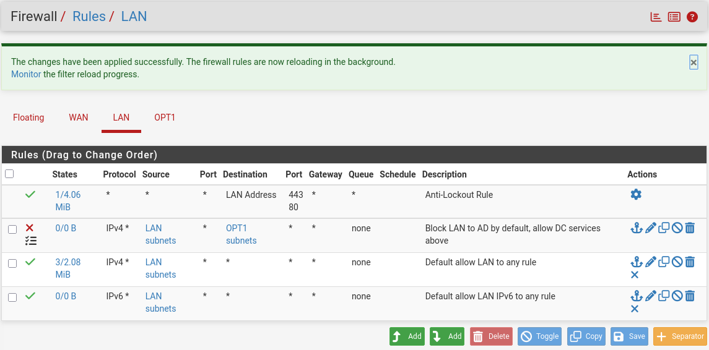
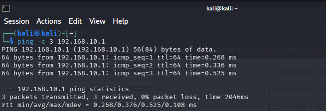
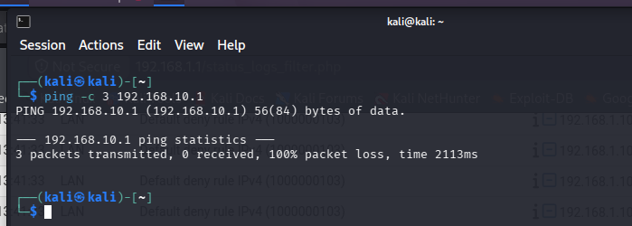
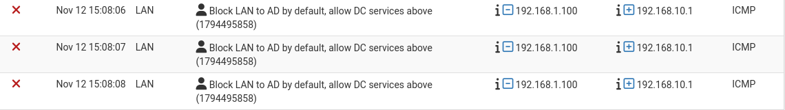
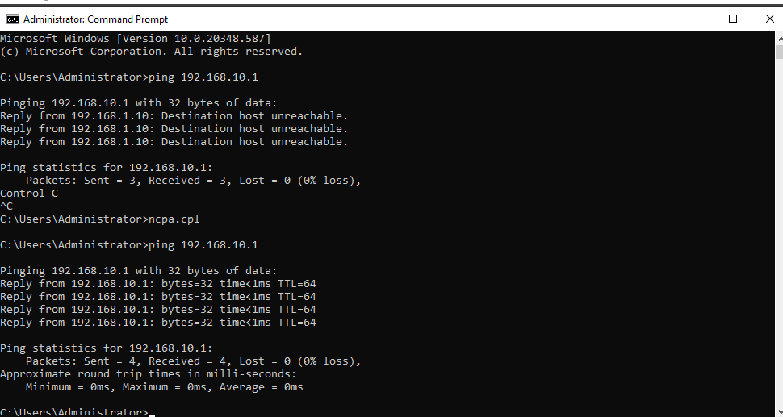
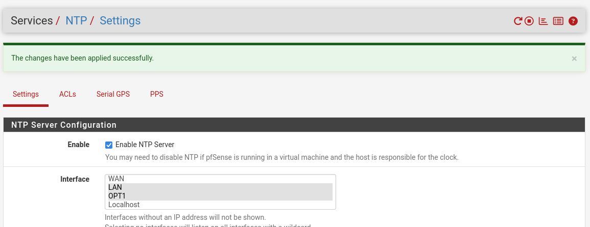
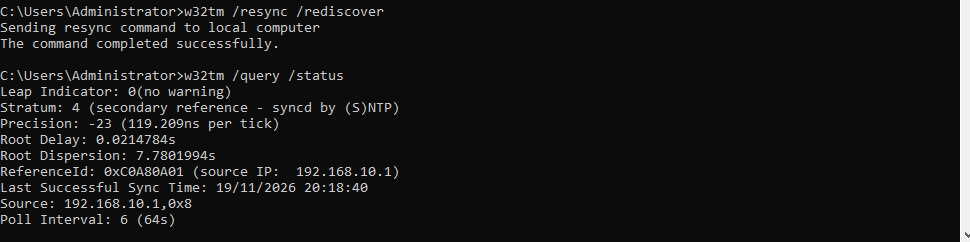
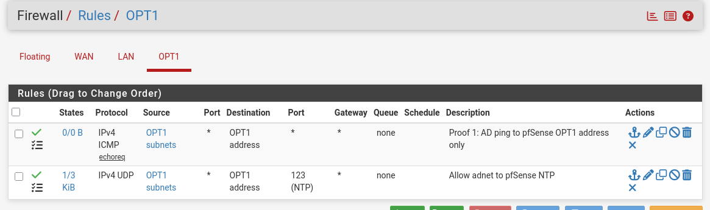
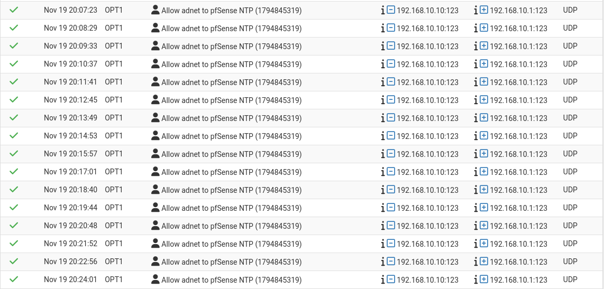

# Building an isolated home lab with pfSense and Kali

**Built:** mid-2026  
**SY0-701 domains:** 3 (Security Architecture), 4 (Security Operations)  
**Tools:** pfSense CE 2.8.1, VirtualBox, Kali Linux

This is the first stage of my home lab: a pfSense firewall in front of an internal VirtualBox network, with Kali as the first machine on it. I built it on my Windows PC while studying for CompTIA A+, Network+ and Security+ and working through TryHackMe.

Where I relied on pfSense's defaults or haven't built something yet, I say so.

## Scope

The lab is one LAN segment behind pfSense. pfSense handles routing and DHCP for it, and I manage it over HTTPS. Kali is on the network and can reach the internet. The point is isolation, keeping lab traffic away from my home network, so this first stage has one WAN and one LAN. In November 2026 I added a second segment for Active Directory and wrote my own rules for it: see [Update, November 2026](#update-november-2026-a-second-segment-and-my-own-rules). What I haven't done is listed under [Limitations](#limitations) and [Next steps](#next-steps).

## Goal

I wanted somewhere to practise attacking, and later defending. That means running scans, starting deliberately vulnerable machines and eventually monitoring the traffic. None of it should land on my home network.

The part of the design that does this is VirtualBox's Internal Network. An internal network is a virtual switch with no connection to the host's network card or my home LAN. The lab VMs can talk to each other and to pfSense, and the only way out is through pfSense's WAN interface.

That boundary works in one direction for now. Nothing on my home network can start a connection into the lab, because pfSense's WAN side blocks unsolicited inbound traffic. The other way is different. The default LAN rule allows traffic to any destination, and VirtualBox NAT sits behind the WAN. So a lab VM could probably still reach devices on my home network. Blocking that is on the list below.

## Architecture

```text
[Internet]
     |
[pfSense WAN  em0]  DHCP client -> 10.0.2.15/24   (VirtualBox NAT)
     |
[pfSense LAN  em1]  static 192.168.1.1/24, DHCP server (.100-.200)
     |
  intnet  (VirtualBox Internal Network)
     |
[Kali Linux]  192.168.1.101 (DHCP)
```

| Interface | VirtualBox adapter | Addressing | Role |
|---|---|---|---|
| WAN (em0) | NAT | DHCP client, `10.0.2.15/24` | Route out to the internet through VirtualBox NAT |
| LAN (em1) | Internal Network `intnet` | Static `192.168.1.1/24`, DHCP pool `.100` to `.200` | Gateway and DHCP for the lab |

A VM joins the lab by setting its own adapter to the same internal network name, `intnet`. pfSense's one LAN adapter serves the whole virtual switch, so I don't need a new pfSense interface for each machine. Kali was the first. Metasploitable2, an Ubuntu VM running Splunk and a Windows 11 endpoint have joined the same LAN since.

`10.0.2.15/24` is VirtualBox's default NAT range, so it's a private address. Nothing here shows a real public IP, my home router's address or a MAC address.

## pfSense VM

| Setting | Value |
|---|---|
| Version | CE 2.8.1 (the current stable release when I installed it) |
| RAM | 1024 MB |
| vCPUs | 2 |
| Disk | 20 GB |
| Guest OS type | FreeBSD (64-bit), set by hand because VirtualBox didn't detect it |
| Firmware | EFI off |

## Build steps

1. Installed pfSense CE from the AMD64 ISO. WAN came up as `em0` on DHCP. I kept the default ZFS/GPT layout and chose Install CE instead of the paid Plus path ("Retry Validation").
2. Got stuck in a boot loop on the first reboot and fixed it (see [Other problems](#other-problems)).
3. Added a second VirtualBox adapter on Internal Network `intnet`, which became the LAN.
4. In the pfSense console, used Assign Interfaces to set WAN = `em0` and LAN = `em1`.
5. Gave LAN a static `192.168.1.1/24` with no upstream gateway. Only WAN needs one.
6. Turned on the DHCP server for LAN with a pool of `192.168.1.100` to `192.168.1.200`.
7. Kept the web GUI on HTTPS when the console offered to switch it to HTTP.
8. Moved Kali onto `intnet`, brought its interface up with DHCP, and then ran into the DNS problem below.

## Firewall rules

I'm running pfSense's default rules. I didn't write them, but I can explain them:

- On LAN, the default "allow LAN to any" rule lets the lab make outbound connections.
- On WAN, all unsolicited inbound traffic is blocked, along with private and bogon source addresses. Nothing from the WAN side reaches the lab unless a rule allows it.

Anything the WAN side doesn't explicitly allow is dropped (implicit deny). When I built this stage I hadn't written rules of my own or read the firewall logs. I did both in November: see the update below.

## DNS troubleshooting

Once Kali had a DHCP lease from pfSense, `ping google.com` failed:

```text
ping: google.com: Temporary failure in name resolution
```

Before blaming the firewall or the internet connection, I pinged a raw IP to separate name resolution from connectivity:

```text
$ ping 8.8.8.8
64 bytes from 8.8.8.8 ... 0% packet loss     # routing, NAT and internet fine
$ ping google.com
ping: google.com: Temporary failure in name resolution   # only DNS fails
```

The IP worked, so routing, NAT and the internet connection were fine and the problem had to be DNS. I pointed Kali at a nameserver by hand:

```text
$ echo "nameserver 8.8.8.8" | sudo tee /etc/resolv.conf
$ ping google.com    # resolves now, ~20 ms replies, 0% loss
```

This is a workaround. `/etc/resolv.conf` is often managed automatically and can be overwritten by the next DHCP lease or a reboot. The lasting fix is to make sure pfSense includes a DNS server in its DHCP offer (Services > DHCP Server) so no one has to patch the file on each client.

The method is to test one layer at a time. If the IP works and the name doesn't, it's DNS, and there's no need to start pulling apart the firewall.

## Other problems

- Boot loop after install. The VM kept rebooting into the installer because the ISO was still attached and booted before the disk. I powered off, removed the ISO under Settings > Storage, and it booted the installed system. I now check this after every VM install.
- No `dhclient` on Kali. `sudo dhclient eth0` gave "command not found" on this image. `sudo dhcpcd eth0` worked and pulled the lease (`offered 192.168.1.101 from 192.168.1.1`, default route via `192.168.1.1`), which also confirmed pfSense was acting as DHCP server and gateway.
- Kali's `.vbox` file didn't show in Import Appliance. The importer only lists `.ova` and `.ovf` files. Double-clicking the `.vbox` file opened it, and switching the file filter to "All files" would have worked too.
- VirtualBox didn't recognise pfSense. I set the guest type to FreeBSD (64-bit) myself.

## Update, November 2026: a second segment and my own rules

Real companies keep the domain controller away from staff machines, because it holds every account in the business. I wanted the lab to work the same way before I build Active Directory, so I gave it its own network behind pfSense.

```text
[pfSense]
   |-- WAN  em0   VirtualBox NAT
   |-- LAN  em1   192.168.1.1/24   (intnet: Kali, Splunk, Windows 11)
   |-- OPT1 em2   192.168.10.1/24  (adnet: Windows Server 2022, 192.168.10.10)
```

I added a third VirtualBox adapter on a new internal network, `adnet`, assigned it to pfSense as OPT1 and gave it a static address with no DHCP. Traffic between the two networks now has to cross pfSense, so pfSense decides what passes and can log it.

### The rules, and why

| Tab | Rule | Why |
|---|---|---|
| LAN | Block, any protocol, LAN subnets to OPT1 subnets, logged | Ordinary lab machines should not reach the Active Directory network. Services the domain needs will get their own allow rules above this one, each with a reason |
| OPT1 | Pass, ICMP echo request only, OPT1 subnets to the OPT1 address, logged | The smallest rule that lets the server test its link to pfSense: one protocol, one message type, one target |

Two things decided where the block went. Rules are checked on the interface where traffic comes in, so a block on traffic from Kali belongs on the LAN tab. And the first rule that matches wins, so the block has to sit above "Default allow LAN to any", or it never runs. Everything else arriving on OPT1 hits pfSense's hidden default deny rule.

{ loading=lazy }

*Figure 1. The LAN tab just after I applied the rule. The block sits second, above "Default allow LAN to any", and the list icon under the red cross shows it is logged.*

### How I proved it

| Proof | Test | Result |
|---|---|---|
| The block works | Kali pinged 192.168.10.1 before and after the LAN block rule | Before: 3 replies. After: no replies, the request timed out |
| The block shows in the log | Status > System Logs > Firewall after the test | Three block lines naming my rule, interface LAN, Kali to 192.168.10.1, ICMP |
| The new network works | The server pinged 192.168.10.1 after I moved it to `adnet` and fixed its address | 4 of 4 replies |

The third test is the control for the first. A silent ping on its own could mean the rule works, or that the network is dead. Because the server on `adnet` can reach pfSense, the silence from Kali comes from the rule.

{ loading=lazy }

*Figure 2. Before the rule. Kali reaches the AD network, because "allow LAN to any" lets it through.*

{ loading=lazy }

*Figure 3. The same ping after the rule. No reply lines at all, just a timeout. Block drops the packet and says nothing.*

{ loading=lazy }

*Figure 4. The firewall log, one line for each of the three pings, each naming my rule. I cropped out the older lines above, because they show public addresses.*

{ loading=lazy }

*Figure 5. The control test on the server. The first ping failed from its old address, and Windows still reported 0% loss. After I set 192.168.10.10, it got 4 of 4 replies.*

### Time for the Active Directory network

A domain controller needs a clock it can trust. Kerberos, the login system in Active Directory, rejects logins by default when two clocks differ by more than 5 minutes. So before I promote the server, it takes its time from pfSense, the same source as the rest of the lab.

Three separate things had to be true.

| Part | What I did |
|---|---|
| The rule | Pass, UDP port 123 only, OPT1 subnets to the OPT1 address, logged |
| The service | pfSense's NTP service had no interface selected, so it listened on every interface, the WAN included. I set it to LAN and OPT1 only |
| The client | On the server: `w32tm /config /manualpeerlist:"192.168.10.1,0x8" /syncfromflags:manual /update` |

I chose LAN and OPT1 because that is where the clients are. The Splunk VM and the Windows 11 endpoint already ask pfSense on the LAN, so OPT1 alone would have cut them off. After the change I checked that the Splunk VM still took its time from 192.168.1.1.

{ loading=lazy }

*Figure 6. 18 November: the NTP service set to LAN and OPT1 only.*

The `0x8` tells Windows to ask in client mode. pfSense does not run Windows, and Microsoft's documentation says some time servers that don't run Windows answer only client mode requests.

| Proof | Test | Result |
|---|---|---|
| The server names pfSense | `w32tm /query /status` on the server | Source 192.168.10.1, last sync at 20:18:40 |
| The rule carried traffic | The States column of the NTP rule on the OPT1 tab | 0/0 B before the server asked, then 1/3 KiB |
| The log names my rule | Status > System Logs > Firewall | 16 pass lines from 192.168.10.10 to 192.168.10.1 on UDP 123, about one every 64 seconds, each naming my rule |

{ loading=lazy }

*Figure 7. 19 November: the server names pfSense as its time source.*

{ loading=lazy }

*Figure 8. The NTP rule on the OPT1 tab after the server started asking. The States column moved from 0/0 B to 1/3 KiB.*

{ loading=lazy }

*Figure 9. The firewall log: one pass line for each time request, each naming my rule.*

### What the update taught me

- A failed ping only means no reply came back. The message tells you where to look. "Destination host unreachable" from my own address meant the server still had its old IP. A timeout meant pfSense dropped the packet on purpose.
- Windows counted those "Destination host unreachable" replies as received, 0% loss. Read the lines, not only the summary.
- Check in order: is the link up, is the address right, does a rule allow it. An interface can be up with a good address and still block every packet.
- Block drops the packet with no answer. Reject answers straight away. Block tells an attacker less.
- My two failed web GUI logins showed up in the system log, and pfSense's brute-force guard (sshguard) scored them as an attack. Failures followed by a success is the pattern a SOC analyst looks for.

## What I learned, and the Security+ links

- Isolation. The Internal Network has no direct path to my home LAN, and the only way out is through pfSense. Since November the lab is also split inside, with the Active Directory network on its own segment.
- Implicit deny. pfSense's WAN side drops any inbound traffic that no rule allows.
- DHCP, DNS and the default gateway. I watched pfSense lease an address and set the default route, and I separated a DNS fault from a routing fault.
- Secure defaults. I kept HTTPS on the management interface.

## Limitations

- Only ping (ICMP) has been tested through the new block. TCP and UDP to the Active Directory network are not tested yet.
- The Windows Firewall on the server has not been tested.
- Lab VMs can probably reach my home network through the default LAN rule.
- No NTP at first, so clocks drifted across VMs. I fixed this later by making pfSense the lab's time source: see [Can I trust the timestamps in my lab SIEM?](timestamps-clock-problem.md).

## Next steps

Done:

- October 2026: every VM on the LAN takes its time from pfSense (see the [timestamps write-up](timestamps-clock-problem.md)).
- November 2026: a second network behind a new pfSense interface (OPT1), a block rule from the LAN, a small pass rule, and the firewall log checked.
- November 2026: time for the Active Directory network, with a rule, the NTP service on two interfaces only, and the server as a client. See the update above.

To do:

- Add allow rules for what the domain needs (DNS, Kerberos, LDAP, SMB, logs to Splunk), each with a reason. Then test TCP and UDP, not only ping.
- Promote the server to a domain controller.
- Add a LAN rule that blocks the lab from reaching my home network's address range, then confirm it from Kali.
- Hand out DNS through pfSense's DHCP settings instead of editing `/etc/resolv.conf`.
- Try Suricata or Snort on pfSense.
- Write up the later stages (Metasploitable2, the Windows 11 endpoint with Sysmon, and Splunk) as separate pages.

---

*Environment: Oracle VirtualBox on Windows, i7-11800H with 32 GB RAM. All addresses shown are private lab ranges.*
