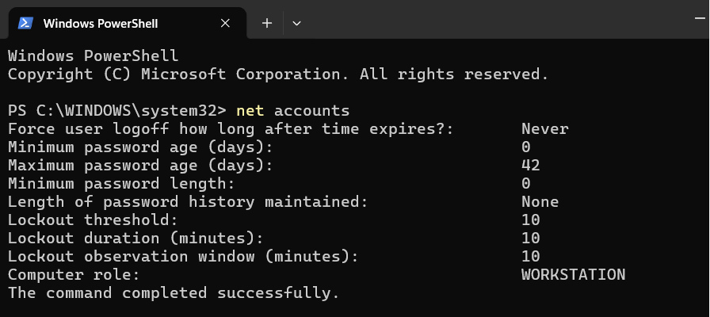
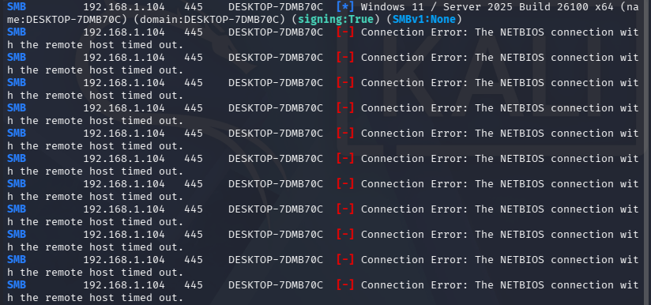
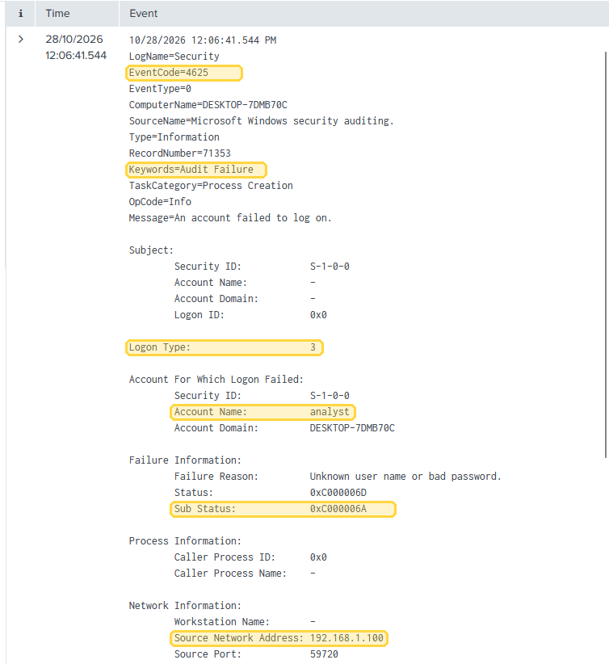
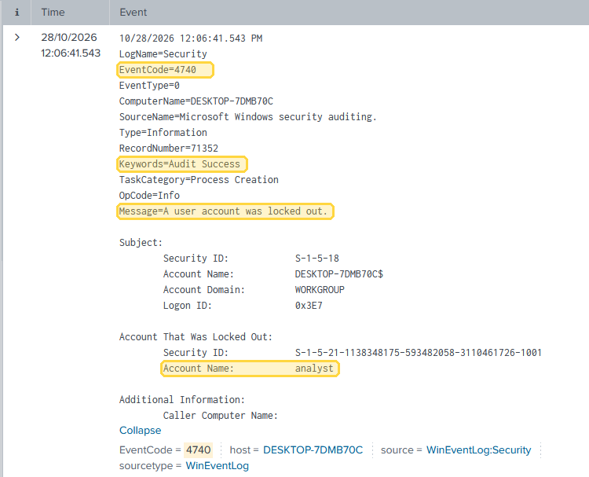
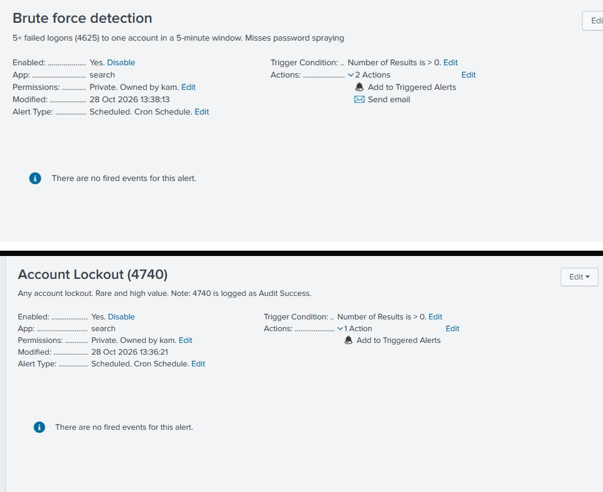

# SMB password guessing: run it, find it, detect it

**Period covered:** 26 to 28 October 2026  
**SY0-701 domains:** 4 (Security Operations)  
**Tools:** Splunk Enterprise 10.4.1, Windows Security auditing, Kali Linux  
**Status:** detection built, password spraying rule not built yet (see [What this misses](#what-this-misses))

This is a lab exercise on my own network. I ran the attack myself against a Windows VM I own so I could learn to spot it from the defender side. Nothing here is a real incident, and this page has no passwords or attack steps. It is about the detection.

## The setup

- Target: a Windows 11 VM with a local account and file sharing over SMB (port 445).
- Source: a Kali Linux VM on the same lab network.
- Collection: a Splunk forwarder on the Windows VM sends the Security log to Splunk on Ubuntu.

SMB is the Windows file and printer sharing protocol. Password guessing over SMB means trying passwords against an account through that service until one works.

## What should happen, and what happened

When someone guesses passwords against a local account, Windows should record each failed attempt as event 4625 (an account failed to log on). My lockout policy locks an account after 10 bad tries. So I expected a run of 4625 events and then a lockout.

{ loading=lazy }
*Figure 1. 27 October: the lockout policy on the Windows VM, checked the day before the test. The weak password rules (minimum length 0, no history) are lab settings, not a recommendation.*

That is what I got. In Splunk:

| What | Event | What it showed |
|---|---|---|
| Failed logons | 4625 | 10 failures on one account in about 18 seconds, roughly 2 seconds apart |
| The lockout | 4740 | one event, right after the 10th failure |
| A later allowed logon | 4624 | a successful network logon, but only after I unlocked the account by hand and used the correct password as part of the test |

{ loading=lazy }
*Figure 2. 28 October: the attack tool reported a timeout on every attempt. I cropped off the command and the password list above it.*

Every 4625 showed the same three things: Logon Type 3 (a network logon, not someone at the keyboard), Sub Status 0xC000006A (the username was real and only the password was wrong), and the Kali VM as the source address.

{ loading=lazy }
*Figure 3. 28 October: one of the 4625 events in Splunk, with the fields I used highlighted.*

{ loading=lazy }
*Figure 4. 28 October: the 4740 lockout, logged in the same second as the last 4625.*

## What I checked

I went through the events with the questions a ticket would ask.

- One account or many? One. That points to guessing against a single account, not password spraying.
- Wrong password or wrong username? The 0xC000006A sub status says the username was valid, so whoever did this already knew a real account name.
- At the keyboard or over the network? Logon Type 3 means another machine.
- Did it work? Not in the attack run. The 10th failure locked the account first.
- Did the attack tool tell the truth? No. It reported connection timeouts, but every attempt still showed up in Splunk. I trust the target's logs over the attacker's output now. I didn't expect to learn that one.

## The detection I built

I saved two searches as alerts in Splunk.

The first looks for the guessing pattern. It counts failed logons per account in five-minute buckets and flags any account with five or more:

```
index=main EventCode=4625
| bucket _time span=5m
| stats count by Account_Name, _time
| where NOT like(Account_Name,"%$")
| where count>=5
| sort - count
```

The `NOT like(Account_Name,"%$")` line drops computer accounts, whose names end in a dollar sign, so they can't trigger the alert on their own.

The second fires on the lockout itself:

```
index=main EventCode=4740
```

{ loading=lazy }
*Figure 5. 28 October: both alerts saved and enabled in Splunk. The "Send email" action shown on the first one was removed later the same day; both now only add to Triggered Alerts.*

Both alerts run every five minutes over the last 15 minutes. I checked the search logic against the events from this exercise, but I haven't yet watched either alert fire on its own. That test is next. More detail on each rule is on the [Detections](../detections/index.md) page, and the same incident written up as a ticket is [HL-2026-1028-01](../tickets/hl-2026-1028-01.md).

## What this misses

The first rule watches for many failures on one account. It would not catch password spraying, where one password is tried against many accounts. Each account stays under five failures, so the rule never fires. Catching that needs a different rule: many different accounts failing from one source address in a short window. I haven't built it yet.

## What I took from it

Event 4625 tells you more than "someone typed a bad password." The logon type, the sub status and the source address together say what kind of attack it is and where it came from. I was also surprised that Windows logs the 4740 lockout as Audit Success, because the lockout action itself succeeded. And the attack tool's own output was wrong about what happened, while the logs on the target were right.
