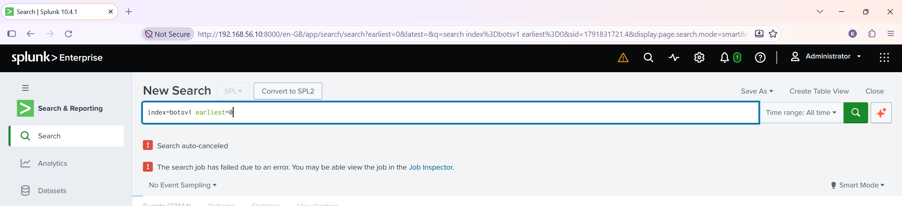
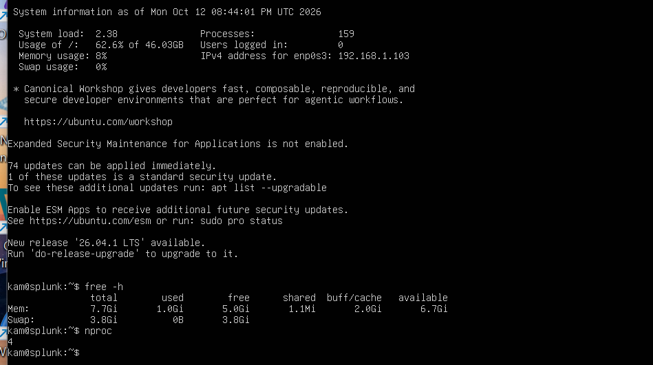
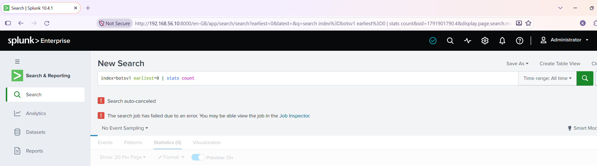
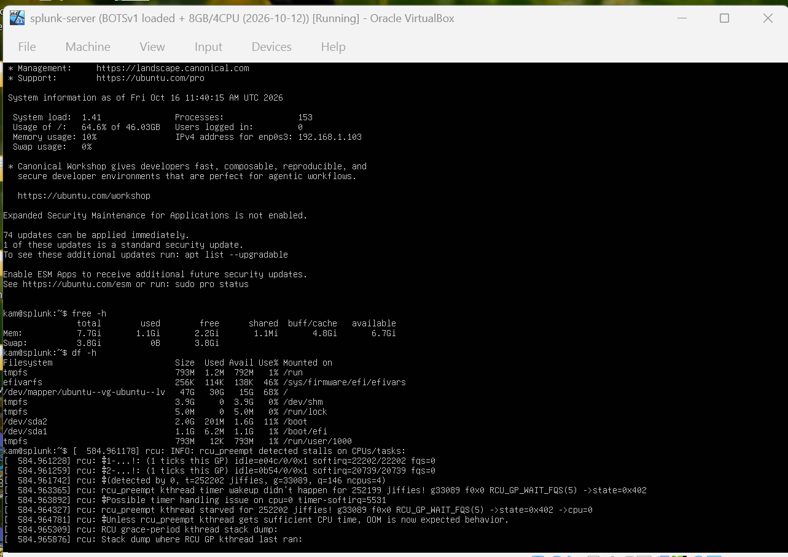
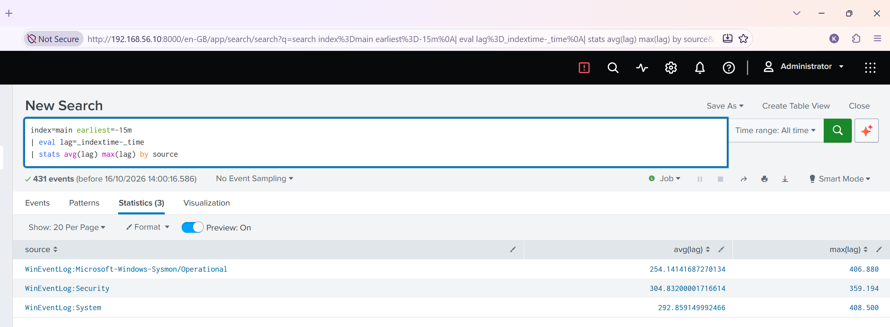
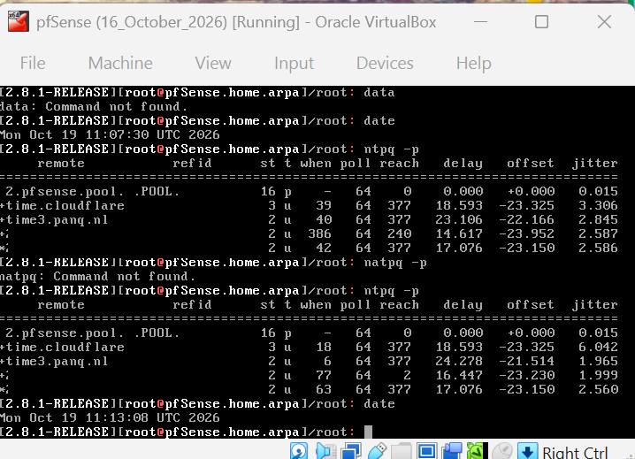
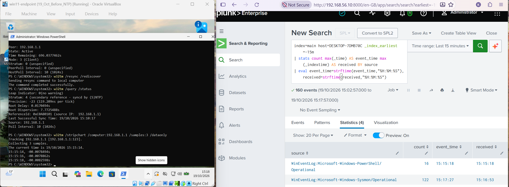
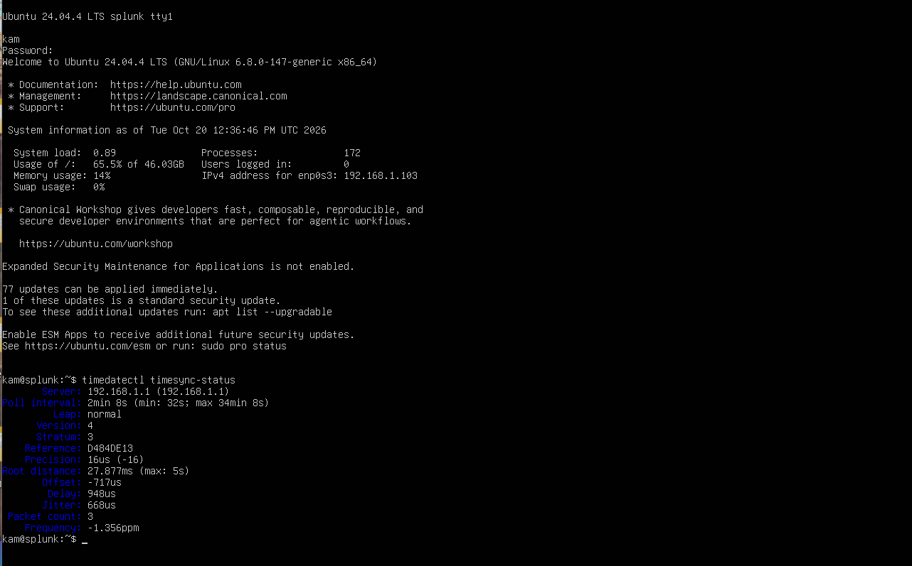
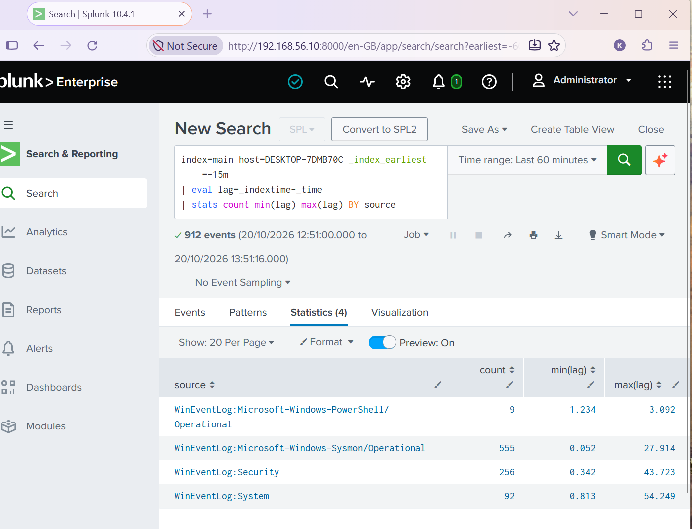

# Can I trust the timestamps in my lab SIEM?

**Period covered:** 12 to 20 October 2026  
**SY0-701 domains:** 4 (Security Operations)  
**Tools:** Splunk Enterprise 10.4.1, pfSense CE, Windows Time service, systemd-timesyncd  
**Status:** clock problem fixed, VM freezing still open (see [Still open](#still-open))

## Summary

I loaded a 33-million-event dataset into Splunk and my searches kept dying. Raising the VM's memory did not fully fix it. The VM also stalled, and the timestamps in my own lab logs did not line up. I traced the timestamp problem to machines that did not share a clock, made my pfSense firewall the lab's time source, and checked the result. The clocks now agree to within milliseconds. The VM stalls are still unexplained.

## The lab

| VM | Role | Address |
|----|------|---------|
| pfSense | Firewall, DHCP, DNS, now NTP | 192.168.1.1 |
| Windows 11 evaluation | Endpoint with Sysmon and the Splunk Universal Forwarder | 192.168.1.104 |
| Ubuntu 24.04 | Splunk Enterprise 10.4.1 | 192.168.1.103 |

VirtualBox on a Windows laptop (i7-11800H, 32 GB). Kali and Metasploitable2 are in the lab too.

## How it started: searches that would not finish (12 October)

I loaded the public Splunk "Boss of the SOC" v1 dataset into its own index, `botsv1`. A raw search over all time kept ending with "Search auto-canceled".

{ loading=lazy }
*Figure 1. 12 October: the first raw search over botsv1 ends in "Search auto-canceled".*

My first theory was that the search was filling the disk. I tested it by running `index=botsv1 earliest=0 | stats count`, which writes almost nothing to disk. It was cancelled too, so the theory was wrong.

The Job Inspector gave the real picture. For the bare search, most of the time went to reading raw events, and it had read about 70,000 of 33,413,777 events (roughly 0.2%) before it was cancelled. My reading is that "auto-cancel" here is an inactivity timeout and not a runtime limit: the search crawled until it stopped reporting progress. The VM had 4 GB of RAM, and Splunk's health panel showed Resource Usage red. A `tstats` count returned the full 33,413,777 in about a second, because it reads the index files and not the raw events.

That evening I raised the VM to 8 GB and 4 vCPUs. `free -h` then showed 7.7 GiB and `nproc` showed 4.

{ loading=lazy }
*Figure 2. 12 October: after the resize, free -h shows 7.7 GiB and nproc shows 4.*

## It kept going wrong (13 to 16 October)

On 13 October the same raw search, `index=botsv1 earliest=0 | stats count`, was auto-cancelled again, now on the bigger VM. So more memory had not made raw searches work.

{ loading=lazy }
*Figure 3. 13 October: the same raw search is auto-canceled again on the bigger VM.*

On 16 October the Splunk VM's console printed kernel warnings: `rcu_preempt detected stalls` and "Possible timer handling issue on cpu=0".

{ loading=lazy }
*Figure 4. 16 October: kernel warnings on the Splunk VM console.*

Later that day I ran a lag check on my own lab data, the gap between when an event says it happened (`_time`) and when Splunk received it (`_indextime`):

```
index=main earliest=-15m
| eval lag=_indextime-_time
| stats avg(lag) max(lag) by source
```

Average lag was 254 s for Sysmon, 305 s for Security and 293 s for System, with maximums up to 408 s. That was my first observation: a large **positive** lag. Events appeared to arrive minutes after they happened. I did not compare the clocks that day, so I did not know why.

{ loading=lazy }
*Figure 5. 16 October: the positive lag, average 254 to 305 seconds per source.*

I had met clock trouble before. In August, searches on "last 15 minutes" had missed events, and I had used "All time" as a workaround and noted that the lab had no shared clock. It was still unfixed in October.

## Why timestamps matter

An investigation reads events from several machines in order. If two clocks disagree, the order is wrong, and a command can look as though it ran before the login that caused it. Kerberos in Active Directory rejects logins when clocks differ by more than 5 minutes by default. And Splunk's time-range searches only work if the event's time is right.

## Following the clock (19 October)

I measured before changing anything.

- pfSense `ntpq -p`: three working upstream servers agreeing at offsets of about -22 to -24 ms, plus a pool entry that was unreachable.
- Win11 `w32tm /stripchart /computer:192.168.1.1`: about 2.7 s off pfSense, and `w32tm /query /status` showed its source as "Local CMOS Clock" and not synchronised.
- Splunk VM `timedatectl timesync-status`: offset +547 ms, jitter 478.5 ms, frequency +500 ppm.

{ loading=lazy }
*Figure 6. 19 October: pfSense's upstream time servers and their offsets. I masked the refid column and the two servers listed by IP address.*

{ loading=lazy }
*Figure 7. 19 October: Win11 sync status and stripchart beside the early lag search.*

Then the lag, per event. I computed `lag=_indextime-_time` for each event and looked at the smallest value per source, not the largest. That was my second observation: every source showed a **negative** lag, roughly -34.6 s to +1.0 s. A negative lag means Splunk "received" an event before it says it happened, which cannot be true. It means the two clocks disagreed at that moment.

So these are two separate observations. On 16 October the lag was **positive** and large, 250 to 400 seconds. On 19 October it was **negative** and small, in seconds. I do not know that they share one cause. I could only tie the 19 October one to the clocks, because that is when I measured them.

### Wrong turns

- **Maximums hid the problem.** My first lag search used `max(_time)` and `max(_indextime)` per source. The gaps looked like small lags of 0 to 34 s. Only the per-event version showed the negative values.
- **A suggested install replaced my time service.** `ntpq` told me to `apt install ntpsec`. I did, and it replaced `systemd-timesyncd`. I reinstalled `systemd-timesyncd` to put it back.
- **I blamed the freezing for the big lag numbers.** Later, drilling into the biggest values showed they were something else (below).

## The fix

pfSense is the single time source. It has the internet connection and answers time requests from the LAN.

On the Splunk VM I created a drop-in file, `/etc/systemd/timesyncd.conf.d/pfsense.conf`, and restarted the service. The file contains:

```ini
[Time]
NTP=192.168.1.1
```

On Win11:

```
w32tm /config /manualpeerlist:192.168.1.1 /syncfromflags:manual /update
w32tm /resync /rediscover
```

The first `/resync` failed with "no time data was available". `/resync /rediscover` worked. After that, `w32tm /query /status` showed source 192.168.1.1, and the stripchart showed about -8 ms.

## Result (20 October)

On the Splunk VM, `timedatectl timesync-status` read: server 192.168.1.1, stratum 3, offset -717 us, jitter 668 us, delay 948 us, frequency -1.356 ppm.

{ loading=lazy }
*Figure 8. 20 October: the Splunk VM syncing from pfSense, offset -717 us.*

The per-source lag check, for events received in the last 15 minutes:

| Source | Events | Min lag (s) | Max lag (s) |
|--------|--------|-------------|-------------|
| PowerShell | 9 | 1.234 | 3.092 |
| Sysmon | 555 | 0.052 | 27.914 |
| Security | 256 | 0.342 | 43.723 |
| System | 92 | 0.813 | 54.249 |

Every minimum is positive. The negative lag is gone.

{ loading=lazy }
*Figure 9. 20 October: per-source lag after the fix. Every minimum is positive.*

The maximums are still tens of seconds. I opened the biggest ones. The largest System value, 54.248 s, covered seven events that all carried the same event time, 13:47:31.752, and were Windows kernel boot messages. The big Security and Sysmon values were events logged within about a minute of the same boot. That fits the forwarder's startup: it connects after boot, and events Windows logged before it connected arrive in one batch. It is not a clock error.

## Still open

- **The Splunk VM still stalls.** On 19 October the kernel logged a 162-second soft lockup, and on 20 October I caught one live: a 23-second lockup on CPU#0 and another on CPU#3 while a Splunk process was running. After the stall the clock was off by about 2 ms, so the clock now survives it, but the stalls are unexplained. I suspect something on the host, and I have not shown it.
- **Win11's Root Dispersion** was 7.78 s on 20 October and I have not rechecked it.
- **Raw searches on the 8 GB VM** were still being cancelled on 13 October. I have no clean explanation yet.
- My early 19 October times are approximate.

## What I learned

- Per-event values show what maximums hide.
- Read what `apt` wants to install before saying yes. It can replace the thing you are fixing.
- Change one setting at a time, and write down what each change did.
- A clean cause for one symptom (big lag from the forwarder's startup) does not explain another (the stalls).
- Do not call something fixed until it has been checked again.

The screenshots above are cropped from my own lab consoles. Only private lab addresses appear; I masked the public IPs of upstream time servers in Figure 6.
